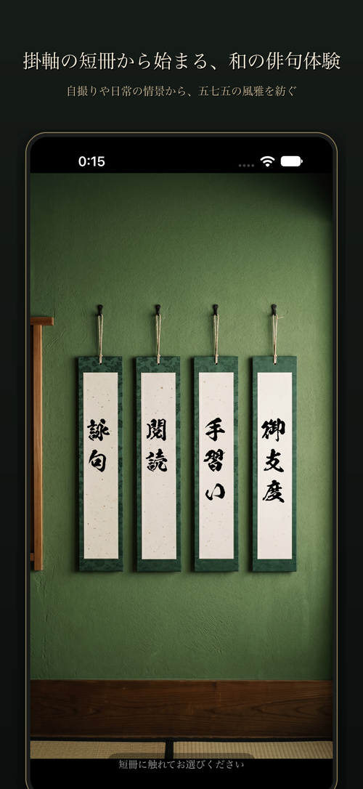
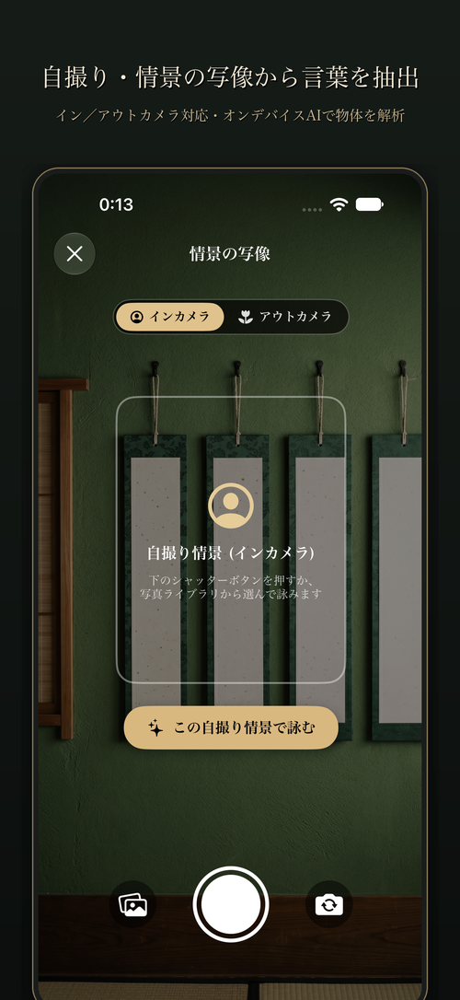
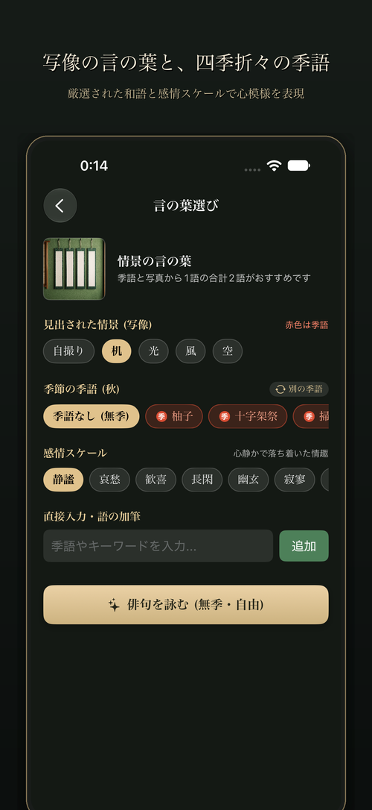
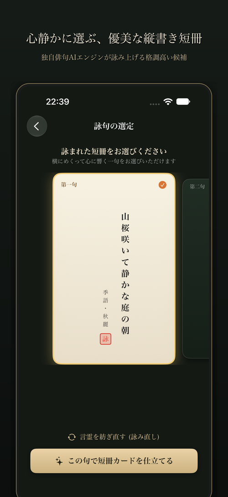

# 俳句地鶏（Haiku Jidori）

**〜 自撮りで始めるAI俳句 〜**

Apple Visionとオンデバイス自然言語AIが、あなたの自撮りや情景写真から言の葉を見出し、本格的な五七五を紡ぎ出します。

---

## 🌐 公式サイト & 公開情報

- **公式サイト（GitHub Pages）**: [https://ssssrabbit.github.io/haiku/](https://ssssrabbit.github.io/haiku/)
- **技術解説（AIアーキテクチャ）**: [https://ssssrabbit.github.io/haiku/technology.html](https://ssssrabbit.github.io/haiku/technology.html)
- **プライバシーポリシー**: [https://ssssrabbit.github.io/haiku/privacy.html](https://ssssrabbit.github.io/haiku/privacy.html)

---

## 📸 アプリ画面

| 1. ホーム画面 | 2. 撮影画面 |
| :---: | :---: |
|  |  |
| **掛軸の短冊から始まる和の体験** | **自撮り・情景の写像から言葉を抽出** |

| 3. キーワード選択 | 4. 候補選択 |
| :---: | :---: |
|  |  |
| **写像の言の葉と四季折々の季語** | **心静かに選ぶ優美な縦書き短冊** |

---

## 🌸 主な特徴

1. **写像の言の葉（Vision×オンデバイスAI）**
   - 撮影した写真から情景や被写体をリアルタイムに認識し、俳句の種となる言葉を抽出します。
2. **四季の季語との調和**
   - 季節に合わせた季語と撮影した被写体を組み合わせ、自然で風雅な句を生成します。
3. **完全オンデバイス処理**
   - 写真データやテキストは端末外へ送信されず、すべてオンデバイスで完結するため安心してお使いいただけます。

---

## 📄 ライセンス

本プロジェクトは [MIT License](LICENSE) のもとで公開されています。
